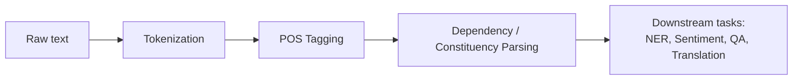
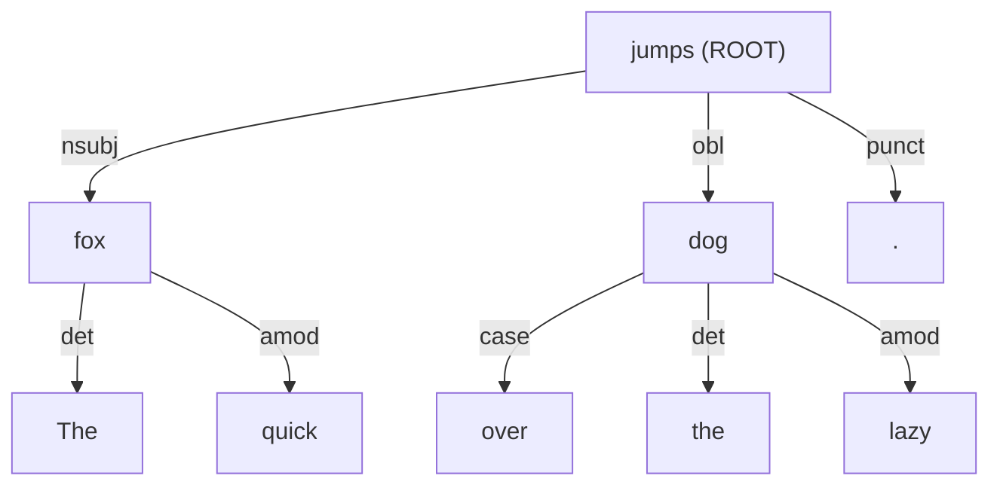
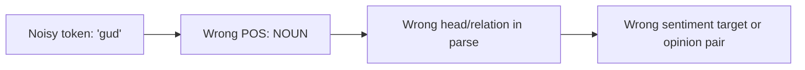

# Syntactic Analysis in NLP: POS Tagging, Dependency Parsing, and Social Media Challenges


## 1. Syntactic Analysis: Definition and Significance

**Syntactic analysis (parsing)** is the NLP task of determining the grammatical structure of a sentence: which words group together, which words modify others, and how they relate (subject, object, modifier, etc.). While tokenization tells us *what the words are*, syntactic analysis tells us *how they fit together*.

**Why it matters:**

- **Disambiguation:** "I saw the man with the telescope" has two readings (who has the telescope?). Only a structural analysis can represent both.
- **Meaning extraction:** Knowing the subject and object of a verb is the basis of information extraction ("Who did what to whom?").
- **Downstream tasks:** Syntax features improve named entity recognition, relation extraction, machine translation, question answering, aspect-based sentiment analysis (which opinion word modifies which product feature), and grammar checking.
- **Negation and scope:** "The camera is *not* good but the battery is great" requires structure to know that "not" attaches to "good", not "great".

### Diagram 1: Where syntactic analysis fits in an NLP pipeline



---

## 2. Part-of-Speech (POS) Tagging

**POS tagging** assigns each token a grammatical category (noun, verb, adjective, etc.). It is usually the first syntactic step, and parsers rely on its output. The central difficulty is **ambiguity**: "book" is a noun in "read a book" but a verb in "book a flight".

### Example (Universal POS tags)

| Token | The | quick | fox | jumps | over | the | lazy | dog | . |
|---|---|---|---|---|---|---|---|---|---|
| **UPOS** | DET | ADJ | NOUN | VERB | ADP | DET | ADJ | NOUN | PUNCT |

### Common tagsets

| Tagset | Size | Notes |
|---|---|---|
| **Penn Treebank** | ~45 tags | Fine-grained (e.g., `NN`, `NNS`, `VBD`, `VBZ`); standard for English news text |
| **Universal POS (UPOS)** | 17 tags | Cross-lingual; used by Universal Dependencies and spaCy (`pos_`) |
| **CMU ARK Twitter tagset** | 25 tags | Adds social-media tags: `#` hashtag, `@` mention, `U` URL, `E` emoticon, `!` interjection |

**Methods:** rule-based taggers, Hidden Markov Models, CRFs, and today neural models (BiLSTM, transformers such as BERT) that use context to resolve ambiguity.

---

## 3. Dependency Parsing

**Dependency parsing** represents a sentence as a tree of **directed, labeled links** between a *head* word and its *dependents*. Every sentence has one **root** (usually the main verb). This differs from **constituency parsing**, which groups words into nested phrases (NP, VP, PP). Dependency parses are more compact and map directly onto "who did what to whom".

### Example: "The quick fox jumps over the lazy dog."

```
jumps (ROOT, VERB)
├── fox (nsubj, NOUN)        <- subject of "jumps"
│   ├── The (det, DET)
│   └── quick (amod, ADJ)    <- adjective modifying "fox"
├── dog (obl, NOUN)          <- oblique (prepositional) argument
│   ├── over (case, ADP)
│   ├── the (det, DET)
│   └── lazy (amod, ADJ)
└── . (punct)
```

### Diagram 2: Same parse as a graph (arrows point from head to dependent)



### Frequent dependency relations (Universal Dependencies)

| Label | Meaning | Example |
|---|---|---|
| `nsubj` | Nominal subject | **fox** jumps |
| `obj` | Direct object | eat **apples** |
| `amod` | Adjectival modifier | **lazy** dog |
| `det` | Determiner | **the** dog |
| `advmod` | Adverbial modifier | **very** fast |
| `case` | Preposition/postposition marker | **over** the dog |
| `cop` | Copula | phone **is** good |

### Quick spaCy demo

```python
import spacy
nlp = spacy.load("en_core_web_sm")
doc = nlp("The quick fox jumps over the lazy dog.")
for t in doc:
    print(f"{t.text:<6} {t.pos_:<6} {t.dep_:<6} head={t.head.text}")
```

---

## 4. Challenges in Syntactically Analyzing Social Media Text

Most taggers and parsers are trained on edited text (e.g., the Wall Street Journal). Social media breaks many of their assumptions, so accuracy drops noticeably: taggers trained on news typically fall to the mid or high 80s percent accuracy on tweets, compared with the mid 90s on news, while tweet-specific taggers recover to around 90-93%. Exact figures vary by dataset and model.

### Worked example: "omg this new phone is sooo gud lol 😍 #blessed @jane"

| Token | omg | this | new | phone | is | sooo | gud | lol | 😍 | #blessed | @jane |
|---|---|---|---|---|---|---|---|---|---|---|---|
| **ARK tag** | `!` | `D` | `A` | `N` | `V` | `R` | `A` | `!` | `E` | `#` | `@` |

An ideal dependency analysis, using the UD copula convention, is:

```
gud (ROOT, ADJ)
├── omg (discourse, INTJ)
├── phone (nsubj, NOUN)
│   ├── this (det, DET)
│   └── new (amod, ADJ)
├── is (cop, AUX)
├── sooo (advmod, ADV)       <- elongated spelling of "so"
└── lol (discourse, INTJ)
```

A news-trained parser often mis-tags "gud" and "sooo" as unknown nouns, which cascades into a wrong tree. This illustrates **error propagation**: parser mistakes follow from tagging mistakes.

### Diagram 3: Error propagation



### Summary of challenges

| Challenge | Example | Effect on syntax | Mitigation |
|---|---|---|---|
| **Misspellings and creative spelling** | "gud", "sooo", "u r gr8" | Out-of-vocabulary words are mis-tagged | Normalization, subword/character models |
| **Missing or irregular punctuation** | "just landed in nairobi so tired cant wait to sleep" | Sentence boundaries unclear; run-ons | Tweet-aware sentence splitting, joint segmentation |
| **Ungrammatical fragments and ellipsis** | "Loving it. So good." / "Best day ever!!!" | No verb or subject; no clear root | Treebanks that annotate fragments (e.g., Tweebank) |
| **Platform-specific tokens** | `#blessed`, `@jane`, URLs | Hashtags may act as words ("I love #pizza") or as metadata | Dedicated tags (`#`, `@`, `U`); hashtag segmentation |
| **Emojis and emoticons** | "I'm fine 🙄" | No standard POS or dependency role | ARK tag `E`; map to `SYM` in UD; keep as tokens |
| **Slang and neologisms** | "ngl", "rizz", "lowkey" | Unknown words, shifting meaning | Frequent retraining, slang lexicons |
| **Code-switching** | "Nimechoka sana, I need a break" | Mixed grammars within a sentence | Language ID, multilingual models |
| **Domain shift** | News-trained parser on tweets | Large accuracy drop | Domain adaptation, fine-tuning on social data |
| **Limited annotated data** | Few social media treebanks | Hard to train supervised models | Semi-supervised learning, transfer from large pretrained models |

---

## 5. Conclusion and Recommendations

1. Syntactic analysis reveals sentence structure and is crucial for tasks that depend on relationships between words, not just word counts.
2. POS tagging provides grammatical categories and is the foundation for parsing. Dependency parsing builds on it by linking heads to dependents with labeled relations.
3. Social media text is noisy, ungrammatical, and constantly changing, so off-the-shelf tools trained on news perform worse and errors compound through the pipeline.
4. Recommended practice: use tools trained or fine-tuned on social media data (e.g., the CMU ARK tagger, TweeboParser, or transformer models fine-tuned on Tweebank); apply light normalization; keep platform tokens (hashtags, mentions, emojis) as explicit tags instead of deleting them; and evaluate on a sample of real posts from the target platform.

