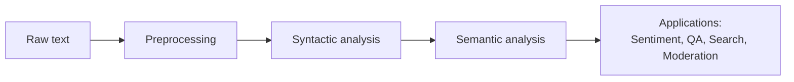
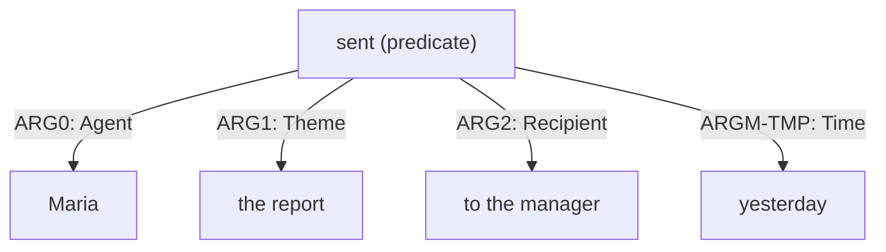
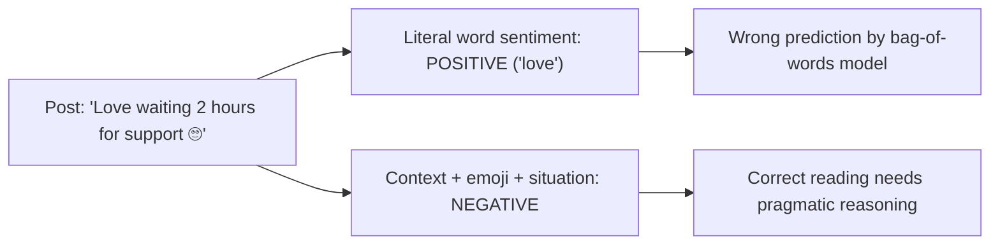

# Semantic Analysis in NLP: Techniques and Social Media Challenges

## 1. Semantic Analysis: Definition and Importance

**Semantic analysis** is the NLP task of determining the *meaning* of words, phrases, sentences, and whole texts. Syntactic analysis tells us how a sentence is built; semantic analysis tells us what it says and what the speaker intends. A sentence can be grammatically perfect and still meaningless ("Colorless green ideas sleep furiously"), which shows that structure and meaning are separate layers.

**Why it matters:**

- **Resolving ambiguity:** "I deposited money at the bank" vs. "We sat on the river bank" need different interpretations of the same word.
- **Extracting facts:** Knowing *who did what to whom* lets systems build knowledge graphs, answer questions, and summarize.
- **Measuring opinion:** Businesses and governments gauge public attitudes toward products, policies, and events.
- **Better search and chatbots:** Matching a query's meaning rather than its keywords ("cheap flights" ≈ "affordable airfare") improves retrieval and dialogue.
- **Content moderation and crisis response:** Detecting hate speech, misinformation, or calls for help depends on meaning, not just vocabulary.

### Levels of meaning

| Level | Question | Example |
|---|---|---|
| **Lexical semantics** | What does each word mean? | "bank" = financial institution or riverside |
| **Compositional semantics** | How do word meanings combine? | "not good" reverses "good" |
| **Pragmatics / discourse** | What is meant in context? | "Nice weather" said during a storm is sarcasm |

### Diagram 1: Semantic analysis in the NLP pipeline

---

## 2. Core Semantic Analysis Techniques

### 2.1 Word Sense Disambiguation (WSD)

**Definition:** WSD chooses the correct meaning (sense) of an ambiguous word from a sense inventory such as **WordNet**, based on context.

**Example:** "I need to *charge* my phone" (supply electricity) vs. "The shop will *charge* you $20" (ask payment) vs. "Police *charged* him with theft" (accuse).

**Approaches:**

| Approach | Idea | Example |
|---|---|---|
| **Knowledge-based** | Compare context with dictionary definitions | Lesk algorithm (overlap between context words and WordNet glosses) |
| **Supervised** | Train classifiers on sense-labeled corpora | SemCor-trained models |
| **Contextual embeddings** | Transformer models give the same word different vectors in different contexts | BERT-based WSD |

**Social media use:** Distinguishing "apple" the company from "apple" the fruit in brand monitoring, or "sick" meaning ill vs. "sick" meaning excellent.

### 2.2 Sentiment Analysis

**Definition:** Sentiment analysis (opinion mining) classifies the attitude expressed in text, typically as positive, negative, or neutral, or along finer emotion categories (joy, anger, fear).

**Levels:** document-level, sentence-level, and **aspect-based** (opinions about specific features, e.g., "great screen but terrible battery").

**Approaches:**

| Approach | How it works | Examples | Strengths and limits |
|---|---|---|---|
| **Lexicon/rule-based** | Scores words from a sentiment dictionary and applies rules for negation and intensifiers | VADER, SentiWordNet | Fast, interpretable, no training data; weak on context and new slang |
| **Classical ML** | Features (TF-IDF, n-grams) fed to Naive Bayes, SVM, logistic regression | Trained on labeled tweets | Good with labeled data; limited context |
| **Deep learning / transformers** | Fine-tuned language models capture context | BERT, RoBERTa, BERTweet | Most accurate; needs data and compute |

**Example scoring:** "The service was **not** good" → a naive bag-of-words model sees "good" and predicts positive, whereas VADER's negation handling and transformer models correctly predict negative.

**Real-world use:** Brands tracking reactions to a product launch, analysts tracking public mood during elections, and health agencies monitoring concern during outbreaks.

### 2.3 Semantic Role Labeling (SRL)

**Definition:** SRL identifies the **predicate-argument structure** of a sentence: for each verb, who is the agent, what is the patient, and what are the time, place, and manner. It is often described as answering "Who did what to whom, when, where, and how?"

**Example:** "Maria sent the report to the manager yesterday."

| Span | Role | Meaning |
|---|---|---|
| Maria | ARG0 (Agent) | The sender |
| sent | Predicate | The action |
| the report | ARG1 (Patient/Theme) | The thing sent |
| to the manager | ARG2 (Recipient) | Who received it |
| yesterday | ARGM-TMP | When it happened |

SRL is robust to paraphrase: "The report was sent to the manager by Maria" has a different syntax but the **same roles**.

### Diagram 2: Semantic roles for one sentence

**Resources:** PropBank and FrameNet supply role annotations; modern SRL systems are mostly BERT-style neural models (e.g., AllenNLP).

### 2.4 Technique comparison

| Technique | Core question | Output | Typical use |
|---|---|---|---|
| **WSD** | Which meaning of this word? | Sense label (e.g., `bank.n.01`) | Search, translation, brand monitoring |
| **Sentiment analysis** | What attitude is expressed? | Polarity or emotion label/score | Reputation tracking, market research |
| **SRL** | Who did what to whom? | Predicate-argument structures | Information extraction, QA, event detection |

---

## 3. Challenges in Semantic Analysis of Social Media Text

Social media posts are short, informal, and heavily dependent on shared context, which makes semantic analysis much harder than for edited text.

### 3.1 Irony and sarcasm

The literal meaning is the opposite of the intended meaning, so word-level sentiment misleads models.

- "Great, my flight got cancelled **again**. Love this airline 🙄" contains positive words ("great", "love") but expresses strong negative sentiment.
- Clues include contrast between positive words and negative situations, exaggeration, hashtags like `#not` or `#sarcasm`, and mismatched emojis. Even so, human annotators often disagree on sarcasm, and models need world knowledge to detect it.

### 3.2 Context loss

Posts are short and often replies in a thread, so the information needed to interpret them is missing.

- "**Same.**" or "**This.**" has no meaning without the post it answers.
- Pronouns and references ("he did it again") lack antecedents.
- Meaning depends on current events, memes, and in-group knowledge.
- **Mitigation:** Include parent posts and thread history, user and timeline features, and timestamps.

### 3.3 Slang, neologisms, and shifting meaning

- "That concert was **sick**" (positive), "he's **cooked**" (in trouble), "**mid**" (mediocre).
- Meanings change quickly and vary by community, so static lexicons go stale.

### 3.4 Emojis and multimodal meaning

- The same emoji can be sincere, ironic, or mean something different across groups (😂, 💀, 🙃).
- Text alone may miss the sentiment carried by images, GIFs, or videos attached to the post.

### 3.5 Multilingual and code-switched text

- "Nimechoka sana, I need a break" mixes Swahili and English; monolingual models and lexicons cover only part of the message.

### 3.6 Negation, scope, and implicit sentiment

- "I can't say I'm unhappy" requires handling double negation.
- Implicit opinion has no sentiment words: "The battery died in two hours" is negative without any explicitly negative term.

### 3.7 Domain shift, bias, and data limits

- Models trained on product reviews perform worse on political tweets.
- Annotation is subjective, and models may reflect dialect or demographic bias (e.g., misclassifying African American English as more negative or toxic).

### Diagram 3: Why a literal reading fails

### Summary of challenges

| Challenge | Example | Impact | Possible mitigation |
|---|---|---|---|
| **Irony/sarcasm** | "Love this airline 🙄" | Polarity flipped | Sarcasm-aware models, emoji and hashtag cues |
| **Context loss** | "Same." | Meaning undefined | Use thread/conversation context |
| **Slang drift** | "sick", "cooked", "mid" | Wrong sense or polarity | Retrain regularly, slang lexicons |
| **Emojis** | 💀 meaning "I'm dying laughing" | Misread tone | Keep emojis as features |
| **Code-switching** | Swahili-English posts | Missed vocabulary | Multilingual models |
| **Implicit sentiment** | "Battery died in two hours" | No sentiment keyword | Aspect-based and contextual models |
| **Bias and subjectivity** | Dialect-related misclassification | Unfair outcomes | Diverse data, bias audits |

---

## 4. Real-World Examples

- **Brand monitoring:** Airlines classify tweets as complaints or praise, route urgent cases to support, and need sarcasm handling to avoid missing angry customers.
- **Public health:** Agencies analyze posts to track vaccine hesitancy or mental-health signals, where wrong sentiment readings have real consequences.
- **Politics and policy:** Analysts gauge reactions to debates and policies, where sarcasm and in-group slang are common.
- **Crisis response:** Systems extract *who needs what and where* (an SRL-style task) from disaster-related posts.

---

## 5. Conclusion and Recommendations

1. Semantic analysis moves NLP from structure to meaning and is essential for applications such as sentiment analysis, QA, and information extraction.
2. WSD resolves word meaning, sentiment analysis captures attitude, and SRL captures event structure. Together they give a layered view of meaning.
3. Social media text is the hardest setting because of irony, missing context, evolving slang, emojis, and code-switching.
4. Recommended practice: use contextual models fine-tuned on social media data (e.g., BERTweet, Twitter-RoBERTa), keep emojis and hashtags as signals, include conversation context where available, update models regularly, and evaluate on a manually labeled sample of the target platform.
5. Be transparent about limitations: even strong models misread sarcasm, so important decisions should not rest on automated sentiment alone.

