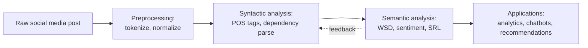
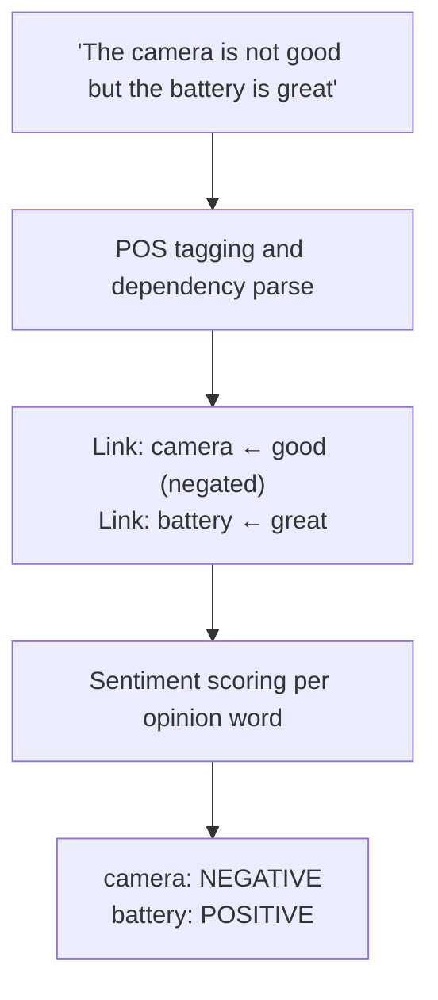
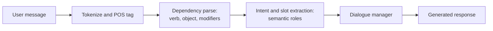

# Syntax Meets Semantics: Combining Syntactic and Semantic Analysis for Social Media Analytics


## 1. Introduction

This report synthesizes our earlier work on text preprocessing, syntactic analysis, and semantic analysis. Each layer answers a different question about language:

| Layer | Question answered | Key techniques (from earlier reports) |
|---|---|---|
| **Preprocessing** | What are the clean units of text? | Tokenization, stemming, lemmatization, normalization |
| **Syntactic analysis** | How is the sentence built? | POS tagging, dependency parsing |
| **Semantic analysis** | What does it mean? | Word sense disambiguation, sentiment analysis, semantic role labeling |

On their own, each layer has blind spots. Combined, they let systems move from raw, noisy posts to reliable understanding of *who said what, about which thing, with what attitude*. We explain how syntax and semantics complement each other, show how the combination improves social media analytics, and describe real systems that rely on both.

### Diagram 1: The layered NLP pipeline



The dotted arrow matters: meaning can also help fix structure. If a sentiment or sense model strongly suggests "sick" is positive, it can help a tagger decide that "sick" here is an adjective of praise, not an illness.

---

## 2. How Syntax and Semantics Complement Each Other

### 2.1 Syntax provides structure; semantics provides meaning

- **Syntax without semantics** can parse "Colorless green ideas sleep furiously" perfectly but cannot tell that it is nonsense.
- **Semantics without syntax** can recognize the words "dog", "bites", and "man" but cannot tell who bit whom. "Dog bites man" and "Man bites dog" contain the same words with opposite meanings, and only structure separates them.

### 2.2 Concrete ways they help each other

| Situation | What syntax contributes | What semantics contributes | Combined result |
|---|---|---|---|
| **Ambiguous words** | POS tag narrows the options ("book" as NOUN vs. VERB) | WSD picks the exact sense within that category | Correct sense, e.g., "charge" = *accuse* |
| **Negation scope** | Dependency link shows `not` modifies "good", not "great" | Sentiment model flips polarity for the right word | "Camera is not good but battery is great" → negative camera, positive battery |
| **Aspect-based sentiment** | Parse links opinion words to nouns (`amod`, `nsubj`) | Sentiment model scores each opinion word | "great screen, terrible battery" scored per feature |
| **Who did what to whom** | Subject/object relations (`nsubj`, `obj`) | SRL assigns Agent, Patient, Recipient | Event extraction from news and crisis posts |
| **Paraphrase and passive voice** | Parse recognizes different surface structure | SRL maps both to the same roles | "Maria sent the report" ≈ "The report was sent by Maria" |
| **Entity linking** | Noun phrases mark candidate entities | Semantics links "Apple" to company or fruit | Correct brand tracking |

### 2.3 Worked example: aspect-based sentiment

Post: *"The camera is not good but the battery is great."*

**Step 1: Syntactic analysis (dependency parse)**

```
good (conj/ROOT)  ── camera (nsubj), is (cop), not (advmod)
great (conj)      ── battery (nsubj), is (cop)
```

**Step 2: Semantic analysis (sentiment applied using the structure)**

| Aspect (from parse) | Opinion word (from parse) | Modifier | Polarity |
|---|---|---|---|
| camera | good | `not` (negation) | **Negative** |
| battery | great | none | **Positive** |

A bag-of-words sentiment tool sees both "good" and "great" and calls the post positive. The combined approach gets both aspects right, which is the kind of detail businesses need.

### Diagram 2: Combined flow for aspect-based sentiment



---

## 3. Improving Social Media Analytics with the Combination

Social media text is short, noisy, and context-dependent (see our earlier reports). Using both layers addresses several of the challenges we identified.

### 3.1 Challenge-to-solution mapping

| Earlier challenge | Weakness of one layer alone | How combining helps |
|---|---|---|
| **Misspellings and slang** (preprocessing) | Parsers fail on unknown words | Normalization plus context: semantic models infer meaning from neighbors while syntax stabilizes structure |
| **Ambiguous words** ("sick", "apple") | POS tag alone is not enough | POS narrows the category; WSD and contextual embeddings choose the sense |
| **Negation** ("not good") | Stop-word removal can erase "not" | Parse keeps negation attached to its target; sentiment model flips polarity correctly |
| **Irony and sarcasm** | Literal word sentiment misleads | Syntactic cues (exaggeration, contrast structure such as "Great, another delay") plus semantic and emoji cues improve detection, though sarcasm remains unsolved |
| **Context loss** | Short posts lack information | Parse identifies unresolved pronouns; semantic models pull in thread history |
| **Ungrammatical fragments** | Parser has no clear root | Semantic models still extract sentiment and entities from fragments, filling gaps where syntax is weak |

### 3.2 Analytics applications

| Application | Syntactic contribution | Semantic contribution | Business value |
|---|---|---|---|
| **Brand monitoring** | Identify which product noun each opinion attaches to | Sentiment and entity disambiguation | Know *what* customers like or dislike, not just *whether* |
| **Customer support triage** | Detect questions, requests, and complaints from sentence form | Classify urgency, emotion, and topic | Faster routing of angry or urgent customers |
| **Crisis and event detection** | Extract subject-verb-object patterns | SRL identifies who needs what and where | Structured alerts from disaster posts |
| **Hate-speech and misinformation detection** | Detect targets of insults through parse links | Classify toxicity and intent | More accurate moderation, fewer false flags |
| **Trend and topic analysis** | Extract noun phrases and hashtags as topic candidates | Cluster by meaning, track sentiment over time | Early detection of emerging issues |
| **Public health surveillance** | Pull out symptom-patient-time structures | Disambiguate "sick" or "high", assess concern | Earlier signals of outbreaks or mental-health trends |

### 3.3 Practical pipeline for a social media analytics project

1. **Collect** posts and metadata (timestamps, thread structure).
2. **Preprocess** with a tweet-aware tokenizer; keep emojis, hashtags, and negations.
3. **Tag and parse** using a model fine-tuned on social media (e.g., ARK tagger or a parser trained on Tweebank).
4. **Run semantic models** (sentiment, WSD or entity linking, SRL where needed).
5. **Fuse outputs** (e.g., attach sentiment to the aspect found by the parser).
6. **Evaluate** on a manually labeled sample from the target platform, and monitor for drift as slang changes.

> **Note on modern models:** Transformer models such as BERT and its social media variants (e.g., BERTweet) learn much syntactic and semantic information implicitly within a single model, so explicit parsers are sometimes skipped. Explicit syntax and semantic layers still help where interpretability, structured output (aspect-opinion pairs, event roles), or small training sets matter.

---

## 4. Real-World Systems That Use Both

### 4.1 Chatbots and virtual assistants

Customer service bots and assistants (such as those used by banks, airlines, and telecom companies) process a message in stages:

| Stage | Syntactic role | Semantic role | Example: "Book me a flight to Nairobi tomorrow" |
|---|---|---|---|
| **Parsing the request** | POS and dependency parse find the verb "book" and its object "flight" | Intent classification: *book_flight* | Intent = book flight |
| **Slot filling** | Prepositional phrase "to Nairobi" and "tomorrow" are attached to the verb | SRL-style roles: Destination, Date | Destination = Nairobi, Date = tomorrow |
| **Disambiguation** | "Book" is tagged as VERB, not NOUN | Sense: *reserve*, not *publication* | Correct action chosen |
| **Response** | Generate a grammatical reply | Maintain dialogue context and entities | "Sure, which airport are you leaving from?" |

Without syntax, the bot might treat "book" as a noun; without semantics, it would not know the user wants a reservation.

### Diagram 3: Chatbot understanding pipeline



### 4.2 Social listening platforms

Commercial tools for social listening and brand analytics (for example Brandwatch, Sprinklr, and Hootsuite Insights) combine entity recognition, topic detection, and aspect-based sentiment. Parsing-style structure helps link opinions to products, and semantic models score the attitude. Vendors rarely publish their exact architectures, so details differ by product.

### 4.3 Recommendation systems

Review-aware recommenders extract aspect-opinion pairs from user reviews and posts, such as "battery: great" or "service: slow", then use them as features. Structure-based extraction pairs each opinion with its feature, and semantic models judge polarity and similarity. A recommender can then suggest a phone to someone who cares about battery life because reviewers praised that specific aspect.

### 4.4 Other examples

- **Search engines and question answering:** Parse the question to find what is being asked, then match meaning rather than keywords.
- **Machine translation:** Syntax reorders words between languages; semantics preserves the intended sense.
- **Information extraction in news and finance:** Event extraction ("Company A acquired Company B") depends on subject-object structure and role labeling.

---

## 5. Limitations and Ethical Considerations

- **Error propagation:** A wrong POS tag or parse can mislead later semantic steps (see Diagram in our syntax report). Joint or end-to-end models reduce this.
- **Domain shift and language drift:** Slang and memes change quickly, so models need regular updates.
- **Persistent hard problems:** Sarcasm, missing context, and multimodal meaning (images, GIFs) still cause errors.
- **Bias:** Models can misread dialects and minority language varieties, producing unfair outcomes in moderation or analytics.
- **Privacy:** Social media data contains personal information, so analysts should anonymize data and follow platform terms and data-protection laws.

---

## 6. Conclusion and Recommendations

1. **Syntax and semantics are complementary.** Syntax gives structure (who is connected to what); semantics gives meaning (what it says and intends). Neither is sufficient alone.
2. **Combining them improves social media analytics** through aspect-based sentiment, correct negation handling, better event and entity extraction, and more accurate moderation and triage.
3. **Real systems already depend on both:** chatbots, social listening tools, recommenders, search, and translation.
4. **Recommended practice:** preprocess carefully (keep emojis and negations), use social-media-tuned models, fuse structural and semantic outputs, evaluate on real samples from the target platform, and monitor for drift and bias.
5. **Future direction:** large pretrained transformers blur the line between layers, but explicit syntactic and semantic analysis remains valuable for interpretability and structured outputs.

